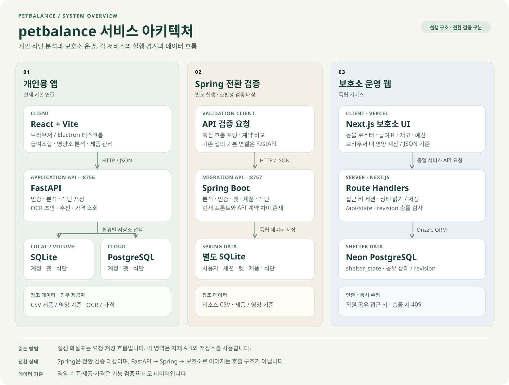
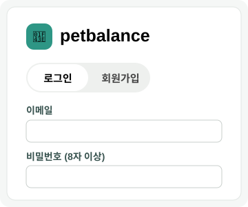
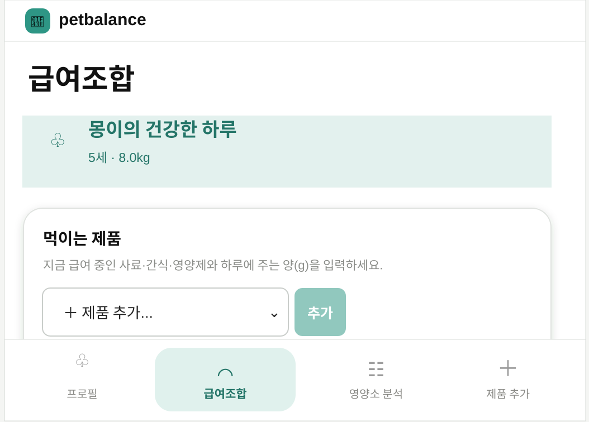
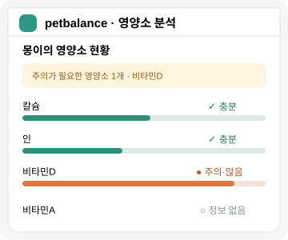
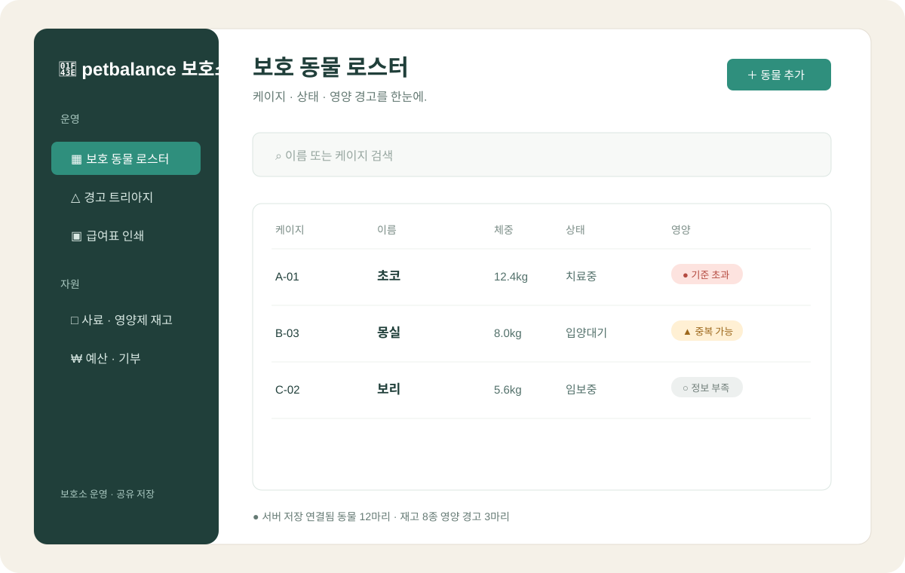

# petbalance

기존 DB·설치 앱을 사용하는 경우 [이름 변경과 데이터 이전 안내](docs/brand-migration.md)를 확인하세요.

## 웹 공유 서버

설치 없이 브라우저로 공유하려면 [웹 서버 배포 안내](docs/server-deployment.md)를 참고하세요.
`Dockerfile`과 `compose.yaml`은 웹 화면·API·영구 저장소를 함께 실행합니다.
외부 공개 시 `WOOAEYOUNG_PUBLIC_SERVER=1`을 사용하고 HTTPS 주소를 연결하세요.

여러 제품(사료·간식·영양제)의 실제 하루 급여량을 합산해 영양소별 총량·상태·제품
기여도와 "확인 필요" 신호를 설명하는 **성견용 데스크톱 앱**입니다.

- **UI**: React + TypeScript + Vite (`frontend/`)
- **분석 백엔드**: FastAPI (`backend/`) — 영양소 환산·합산·상태 판정·기여도·OCR 초안·저장/복원
- **설치형 셸**: Electron + electron-builder (`desktop/`, `build/`) — 백엔드를 sidecar 로 띄우고 창을 연다
- **레거시**: 기존 Streamlit 프로토타입은 `legacy/app.py` 로 보존 (신규 앱에는 불필요)

## 빠른 시작 (개발)

```bash
# 1) 백엔드 의존성
python -m venv .venv && .venv\Scripts\Activate.ps1   # (macOS/Linux: source .venv/bin/activate)
pip install -r requirements.txt

# 2) 프론트엔드 + 셸 의존성
npm install            # 루트 → frontend 까지 설치(postinstall)

# 3) 개발 모드: API(8756) + Vite(5173) + Electron 창을 함께 실행
npm run dev
```

브라우저만 쓰고 싶다면 두 개의 터미널에서:

```bash
npm run backend        # http://127.0.0.1:8756  (분석 API + 빌드된 UI)
npm run frontend:dev   # http://127.0.0.1:5173  (HMR 개발 서버, /api 는 8756 로 프록시)
```

## 설치 파일 빌드 (Windows .exe)

```bash
pip install -r requirements.txt          # pyinstaller 포함
npm install
npm run dist
```

`npm run dist` 는 순서대로:

1. `frontend/` 를 `frontend/dist/` 로 빌드
2. PyInstaller 로 백엔드를 `dist/wooaeyoung-backend/` 폴더 실행파일로 동결 (CSV·빌드된 UI 포함)
3. electron-builder 로 `release/WooAeyoung-Setup-<버전>.exe` (NSIS) 생성

패키지 앱은 분석 서버를 빈 포트로 띄우고 `/health` 확인 후 창을 엽니다. 저장 DB 는
사용자 데이터 폴더(`%APPDATA%/우애영/wooaeyoung.db`)에 만들어집니다.

## 아키텍처

```
frontend/           React SPA — 사이드바 앱 레이아웃
  src/state/        auth.tsx(계정) · session.tsx(조합, 250ms 디바운스 재분석)
  src/components/   AppShell · Sidebar · AuthGate · Dashboard · RecommendView ·
                    PricesView · UnitConverter · StandardsInfo · SettingsView …
backend/            FastAPI
  api.py            REST — 인증 · 카탈로그 · 세션 분석 · 추천 · 가격 · 단위 · OCR · 저장/복원 · CRUD
  auth.py           F-028 — PBKDF2 + 세션 토큰, 사용자별 데이터 분리
  nutrition.py      calculate_intake / summarize_intake / product_contributions
  nutrients.py      F-032 — 성분명 정규화 사전(24종)
  units.py          F-011 — %, mg/kg, IU/kg, mg/정 → 기준량당 mg
  recommend.py      F-019 — 규칙 기반 대체 제품 점수·순위
  pricing.py        F-021 — PriceProvider 인터페이스 + CsvPriceProvider(데모)
  ocr.py            F-007 — 이미지 전처리 + pytesseract(선택 의존)
  label_ocr.py      라벨 텍스트·이미지 → 제품 초안(사람 확인 필수)
  database.py       SQLite CRUD + 스키마 자동 보장 + 컬럼 마이그레이션
desktop/main.js     Electron 메인 — 백엔드 spawn, health 대기, 창 로드, 종료 시 정리
build/              PyInstaller spec, electron-builder buildResources
data/processed/     products.csv(23종) · nutrient_standards.csv(AAFCO 환산) · prices.csv
legacy/app.py       (참고용) 기존 Streamlit UI
```

### 주요 엔드포인트

| 메서드 | 경로 | 용도 · 기능ID |
|---|---|---|
| POST | `/api/auth/register` `/login` `/logout` · GET `/api/auth/me` | 온라인 계정 (F-028) |
| GET | `/api/catalog/products` `…/standards` | 카탈로그(23종)·기준표(출처·버전 포함, F-023/024/034) |
| POST | `/api/session/analyze` | 저장 없이 현재 조합 분석(요약 + 기여도, F-012/013/016) |
| POST | `/api/recommend` | 대체 제품 추천 — 과잉·중복 신호 감소 순위 (F-019) |
| GET | `/api/prices/{product_id}` | 판매처별 가격·최저가 (F-021, 데모 어댑터) |
| POST | `/api/units/convert` · GET `/api/units` | 단위 환산 %, mg/kg, IU/kg, mg/정 (F-011) |
| GET | `/api/ocr/available` · POST `/api/ocr/draft` `/confirm` | 라벨 OCR 초안(자동 확정 안 함, F-006/007/008) |
| POST | `/api/session/save` · GET `/api/session/restore/{pet_id}` | 프로필·식단 저장/복원, 로그인 시 사용자별 분리 (F-026/028) |
| GET | `/api/analyze` `/api/contributions` `/api/pets` `/api/products` | 저장 기반 분석·CRUD (F-027) |

### 온라인 계정 · 여러 기기

인증은 백엔드(FastAPI)에 내장되어 있습니다. 설치형 앱은 기본적으로 내장 로컬 백엔드를
쓰지만, **설정 → 서버 주소**에 팀이 호스팅한 백엔드 URL을 입력하면 여러 기기가 같은
계정·데이터를 공유합니다. 비밀번호는 PBKDF2-HMAC-SHA256(사용자별 salt), 세션은 만료
토큰 테이블로 관리합니다.

## 안전 범위

- 포함: 라벨 수치 단위 환산·합산·기여도·정보 누락 표시
- 제외: 질병 진단, 치료·처방, 약물 상호작용, 급여 중단 지시, OCR 자동 확정
- 현재 기준값(`nutrient_standards.csv`, `verified=false`)은 계산 흐름 검증용 데모이며 실제 급여 판단에 쓸 수 없습니다.

## 구현 현황 (기능 명세서 34개)

전 항목 구현. 외부 데이터가 필요한 항목은 **교체 가능한 어댑터 + 데모 데이터**로 동작하며 UI에 명시:

- F-021 최저가: `pricing.PriceProvider` — 실연동 시 어댑터만 교체
- F-023 제품 데이터: `products.csv` 23종(4종 검수 + 19종 합성, `source` 컬럼으로 구분)
- F-024 공식 기준표: AAFCO 성견 유지기 프로파일을 10kg·600kcal/day로 환산, `verified=false` (수의영양학 검토 대기)
- F-007 이미지 OCR: 전처리 + `pytesseract`(선택 설치). 미설치 시 텍스트 붙여넣기로 대체

## 테스트

```bash
python -m unittest discover -s tests -v      # 백엔드 63개 (nutrition/label_ocr/api/features/레거시)
cd frontend && npm run build                 # 프론트 타입체크 + 프로덕션 빌드
```

## 프로젝트 구조

- `docs/`: 문제 정의, 결정 로그, 데모 스크립트
- `design/`: 사용자 흐름, Figma 핸드오프
- `sql/`: 스키마·시드·쿼리·테스트
- `data/raw/` · `data/processed/`: 원본 / 재생성 가능한 가공 데이터
- `reports/`: 지표와 검증 결과

---

# petbalance

반려동물의 식단과 보호소 운영을 더 명확하고 안전하게 만드는 서비스를 만듭니다.

## 서비스 구성

| 서비스 | 용도 | 기술 |
| --- | --- | --- |
| **petbalance 웹 앱** | 급여조합·영양소 분석 | React + Vite, FastAPI |
| **petbalance 설치형 앱** | 같은 화면을 데스크톱으로 패키징 | Electron, PyInstaller |
| **petbalance Android 앱** | 배포된 웹 서비스에 연결하는 모바일 앱 | Capacitor, Android |
| **Spring Boot 백엔드** | 핵심 분석·인증·펫·제품·식단 API | Java, Spring Boot, SQLite |
| **petbalance 보호소** | 로스터·경고·급여표·재고·예산 | Next.js, Vercel, Neon Postgres |

## 아키텍처



세 영역은 각자의 API와 저장소를 사용합니다. 그림의 실선은 요청·저장 흐름을 나타냅니다.

- **개인용 앱**: React + Vite 화면을 브라우저와 Electron에서 사용하며, Android 앱은 Capacitor로 배포된 HTTPS 서비스에 연결합니다. 기본 로컬 API는 FastAPI `:8756`입니다. 로컬·영속 볼륨 환경에서는 SQLite, 클라우드 구성에서는 PostgreSQL을 사용합니다.
- **Spring 전환 검증**: Spring Boot `:8757`은 핵심 기능을 이식한 별도 구현입니다. 독립 SQLite와 리소스 CSV를 사용하며, 기존 프론트와의 API 호환성을 검증하는 대상입니다.
- **보호소 운영 웹**: Vercel의 Next.js 앱이 자체 Route Handlers와 Neon PostgreSQL로 상태를 저장합니다. 영양 계산은 브라우저의 TypeScript와 JSON 기준 데이터로 수행합니다.

개인용 앱과 Spring은 제품·영양 기준 CSV를 참조합니다. 보호소는 공유 접근 키로 인증하고, `revision`으로 동시 수정 충돌을 감지합니다.

## 주요 화면

<table>
<tr>
<td width="25%" align="center"></td>
<td width="25%" align="center"></td>
<td width="25%" align="center"></td>
<td width="25%" align="center"></td>
</tr>
<tr>
<td align="center"><b>로그인</b><br />이메일 계정으로 시작합니다.</td>
<td align="center"><b>급여조합</b><br />사료·간식·영양제와 하루 급여량을 관리합니다.</td>
<td align="center"><b>영양소 분석</b><br />총량과 참고 범위, 확인 필요 신호를 보여줍니다.</td>
<td align="center"><b>보호소 로스터</b><br />동물·케이지·상태·영양 경고를 관리합니다.</td>
</tr>
</table>

## 운영 흐름

`프로필` → `급여조합` → `영양소 분석` → `제품 추가`

보호소 직원은 접근 키로 로그인한 뒤 `보호 동물 로스터` · `경고 트리아지` · `급여표 인쇄` · `사료 재고` · `예산·기부`를 사용합니다.

## 배포

- 웹 앱: FastAPI 서버가 정적 프론트엔드와 API를 함께 제공하며, Vercel + PostgreSQL 배포 구성을 지원
- 설치형 앱: Electron + PyInstaller + electron-builder
- Android 앱: Capacitor 기반으로 배포된 HTTPS 웹 서비스에 연결
- 보호소 웹: Vercel 프로젝트 `shelter`, Neon Postgres 저장소
- 임시 공유: Cloudflare Tunnel

## 프로젝트

> 현재 영양 기준·제품·가격 데이터는 기능 검증용 데모입니다. 실제 급여 판단이나 수의학적 처방을 대체하지 않습니다.
